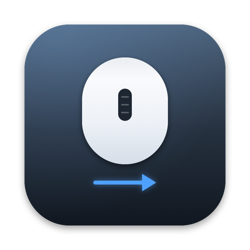

# OneMouse

[简体中文](README.md) | **English**

A macOS menu bar utility that folds two things into one app:

- **Kill pointer acceleration outright** — the hard way, like ExactMouse, not the toggle in System Settings
- **Smooth scrolling** — inertial interpolation, like Mos

Lightweight, no background polling, native arm64.

<p align="center">
  
</p>

## Why not just install two apps

Pointer and scroll wheel hook into completely different layers:

| Layer | Hook point | Owner |
|---|---|---|
| Pointer | `HIDMouseAcceleration` (private IOHIDSystem parameter) | Pointer controller |
| Scroll | `scrollWheel` events (`CGEventTap`) | Scroll controller |

They don't interfere. The real payoff of merging is one menu, one permission, one login item — and the two states can be coordinated (once pointer acceleration is gone, the scroll feel changes, so scroll parameters can follow).

## Why the built-in "turn off pointer acceleration" feels different

Since macOS 14 System Settings has a *Pointer acceleration* toggle, but it uses **a different mechanism**:

- The system toggle writes the `com.apple.mouse.linear` preference plus the `HIDUseLinearScalingMouseAcceleration` flag, which is **only read at login / init**. Changing it requires a logout. Writing that flag directly returns success but the value doesn't change — measured.
- This tool writes `HIDMouseAcceleration`, which takes effect **immediately** and keeps part of the tracking-speed slider behaviour.

So the two do feel different — that's not your imagination. If you want the hard "no acceleration at all, speed not tied to the slider" behaviour, this is the only route.

## Features

- Pointer: three-state linear guard, restores the system value on quit
- Pointer: re-applies automatically after sleep/wake (the system resets the value)
- Scroll: smooth scrolling, three strength levels
- Scroll: non-continuous events only — **trackpad and Magic Mouse continuous scrolling passes through untouched**
- Scroll: self-injected events are tagged, so no feedback loop
- Recovers automatically when the event tap is disabled by the system on timeout
- Launch at login (`SMAppService`)
- Single-instance guard

## Requirements

- macOS 13 or newer (tested on macOS 27)
- Apple Silicon (the build output is arm64 only; on Intel, tweak the `-arch` flag)
- Building needs Command Line Tools only — **no Xcode.app required**

## Build

```bash
./build.sh
# output: build/OneMouse.app
```

`build.sh` compiles directly with `swiftc`, linking `Cocoa` / `IOKit` / `ApplicationServices`.

## Install

```bash
cp -R build/OneMouse.app /Applications/
open /Applications/OneMouse.app
```

On first run it asks for Accessibility permission (required to rewrite scroll events):

**System Settings → Privacy & Security → Accessibility → check OneMouse**

If it isn't listed, click `+` below the list and pick `/Applications/OneMouse.app`.

## The Release build won't open on first launch

This project has no Apple Developer certificate and therefore can't be notarized, so a downloaded copy is blocked by Gatekeeper with "unidentified developer" or "Apple cannot check it for malicious software".

Either of these works:

```bash
# Option 1: right-click the app → Open → Open again
# Option 2: strip the quarantine flag
xattr -dr com.apple.quarantine /Applications/OneMouse.app
```

Once allowed, it won't be blocked again.

## The big trap during development: rebuilding loses permission

Accessibility grants are keyed to the **code signature**:

- With an ad-hoc signature (`codesign -s -`), the system identifies the app by **cdhash**, which changes on every rebuild.
- When it changes, the system finds the old record by bundle id, sees the fingerprint mismatch, and **silently denies** — no dialog, no warning, the checkbox still looks ticked, but you have no permission.

The symptom is "I granted it but it doesn't work". The fix is to sign with a fixed self-signed certificate so the designated requirement binds to the certificate instead of the cdhash:

```bash
# Generate a self-signed code signing certificate
openssl req -x509 -newkey rsa:2048 -sha256 -days 3650 -nodes \
  -keyout om.key -out om.crt \
  -subj "/CN=OneMouse Local Signing" \
  -addext "keyUsage=critical,digitalSignature" \
  -addext "extendedKeyUsage=critical,codeSigning" \
  -addext "basicConstraints=critical,CA:false"

openssl pkcs12 -export -inkey om.key -in om.crt -out om.p12 \
  -passout pass:om -name "OneMouse Local Signing"

# Import into the keychain and trust it (prompts for your password once)
security import om.p12 -k ~/Library/Keychains/login.keychain-db -P om -T /usr/bin/codesign
security add-trusted-cert -r trustRoot -k ~/Library/Keychains/login.keychain-db om.crt
```

After that `build.sh` picks up the certificate automatically (falling back to ad-hoc with a warning if absent). Rebuild as often as you like — the grant stays.

## Menu

| Item | Behaviour |
|---|---|
| Pointer: disable acceleration (linear) | Checkbox state is read from the live system value, not tracked internally |
| Scroll: smooth | Turning it off passes every scroll event through unchanged |
| Smoothing strength | Light / Medium / Strong |
| Launch at login | Registers as a login item |
| Quit | Restores the system default acceleration before exiting |

## Tuning

Takes effect immediately, no restart:

```bash
# Global scroll distance multiplier, 0.3 – 2.5
defaults write io.local.onemouse.om scrollDistanceScale 0.7

# Dump raw scroll deltas to /tmp/onemouse-scroll.log (max 60 lines per process)
defaults write io.local.onemouse.om debugScroll -bool true
```

Level mapping (pixels per line / per-frame decay):

| Level | px per line | Decay |
|---|---|---|
| Light | 9 | 0.26 |
| Medium | 14 | 0.32 |
| Strong | 22 | 0.40 |

## Diagnostics

```bash
/Applications/OneMouse.app/Contents/MacOS/OneMouse --diagnose
/Applications/OneMouse.app/Contents/MacOS/OneMouse --login-on
/Applications/OneMouse.app/Contents/MacOS/OneMouse --login-off
```

> Note: running the binary straight from a terminal makes `AXIsProcessTrusted()` **report a false positive** (TCC attributes the grant to the terminal). To read the real state, launch it from Finder or with `open`, then check `/tmp/onemouse-status.txt`.

## Known limitations

- The pointer layer uses **private APIs**: `NXOpenEventStatus` + `IOHIDSetAccelerationWithKey`, resolved at runtime via `dlsym`. Apple can break them at any time; this also makes the app unsuitable for the App Store.
- `HIDUseLinearScalingMouseAcceleration` can't be written (returns success, value unchanged), so the exact behaviour of the native system toggle can't be reproduced.
- Vertical scrolling only; horizontal wheel input (`dx`) is passed through.
- No button remapping, no per-app profiles.

## Disclaimer

**Why this exists**

On macOS, "disable pointer acceleration" and "smooth scrolling" have long belonged to two separate tools: SteelSeries ExactMouse Tool for the former, Mos for the latter. The features don't overlap, but using both means running two background apps — two menu bar icons, two login items, two permission setups.

This project simply puts both into a single process. The idea comes from those two apps; the code was written from scratch.

**Relationship to those projects**

- **Not affiliated with** the authors or projects of SteelSeries or Mos, and not endorsed by them.
- **Contains no code from, and was not derived from,** either project. The pointer layer calls system private APIs via `dlsym`; the scroll layer is an independent event-interpolation implementation. Mos is licensed CC BY-NC 4.0; this project is an independent implementation, not subject to that licence, and is released under MIT.
- Product names are mentioned only to describe feature equivalence. Trademarks belong to their respective owners.

**Risks**

- The pointer layer writes system HID acceleration parameters — an **undocumented interface**. It may stop working or change behaviour after a macOS update, with no compatibility guarantee.
- The app restores system defaults on a normal quit; it **will not restore them on a crash, force-quit or power loss**. Those values exist only at runtime, so **logging out or rebooting restores the defaults** — no manual repair needed.
- Provided **as is**. The author accepts no liability for any direct or indirect damage arising from use. Evaluate it yourself before using it in a critical environment.
- Not notarized, no developer certificate — Gatekeeper will block the first launch. The build makes no network requests and contains no telemetry; you can verify by building from source.

**If you only need one of the two features**

The originals are the safer bet — Mos occupies the same niche and is more mature; the original ExactMouse relies on Rosetta and has been left behind by newer systems, so use the built-in system toggle if you only need pointer linearization. The sole reason this project exists is to install one app instead of two.

## License

MIT — see [LICENSE](LICENSE).
