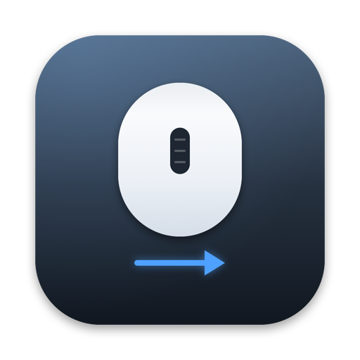

# OneMouse

**简体中文** | [English](README.en.md)

macOS 菜单栏小工具，把两件事合成一个 App：

- **指针加速度彻底关掉**（ExactMouse 那种硬关，不是系统设置里的那个开关）
- **滚轮平滑滚动**（Mos 那种带惯性的插值）

轻量、无后台轮询、arm64 原生。

<p align="center">
  
</p>

## 为什么不是"装两个 App"

指针和滚轮挂的是完全不同的两层：

| 层 | 挂接点 | 谁在用 |
|---|---|---|
| 指针 | `HIDMouseAcceleration`（IOHIDSystem 私有参数） | 指针控制器 |
| 滚轮 | `scrollWheel` 事件（`CGEventTap`） | 滚动控制器 |

两者互不干扰，合并的真实收益是：单菜单、单权限、单开机自启项，以及状态能联动（指针关掉后手感变了，滚动参数可以跟着调）。

## 系统内置的"关指针加速"为什么不一样

macOS 14 起系统设置里有了「指针加速度」开关，但它是**另一套机制**：

- 系统开关写的是 `com.apple.mouse.linear` 偏好 + `HIDUseLinearScalingMouseAcceleration` 标志，**只在登录/初始化时读取**，改了要登出才生效；实测直接写那个标志位返回成功但值不变。
- 本工具写的是 `HIDMouseAcceleration`，**即时生效**，且保留跟踪速度滑块的部分特性。

所以两者手感不同不是错觉。要那种"完全没加速、速度也不随滑块变"的硬关，只能走这条路。

## 功能

- 指针：关闭加速（线性）三态守护，退出时自动还原系统值
- 指针：睡眠唤醒后自动重新施加（系统会把值重置）
- 滚轮：平滑滚动，三档强度
- 滚轮：只处理非连续事件，**触控板和妙控鼠标的连续滚动原样放行**
- 滚轮：给自身注入的事件打标记，不会形成反馈循环
- 事件监听被系统超时禁用时自动恢复
- 开机自启（`SMAppService`）
- 单实例保护

## 系统要求

- macOS 13 或更新（在 macOS 27 上实测）
- Apple Silicon（构建产物只有 arm64；Intel 需自行改 `-arch` 参数）
- 构建只需要 Command Line Tools，**不需要 Xcode.app**

## 构建

```bash
./build.sh
# 产物：build/OneMouse.app
```

`build.sh` 用 `swiftc` 直接编译，链接 `Cocoa` / `IOKit` / `ApplicationServices`。

## 安装

```bash
cp -R build/OneMouse.app /Applications/
open /Applications/OneMouse.app
```

首次运行会请求「辅助功能」权限（改写滚轮事件必需）：

**系统设置 → 隐私与安全性 → 辅助功能 → 勾选 OneMouse**

如果列表里没有，点列表下方的 `+`，选 `/Applications/OneMouse.app`。

## 从 Release 下载的版本首次打不开

本项目没有 Apple 开发者证书，做不了公证（notarization），所以从网上下载的包会被 Gatekeeper 拦住，提示"无法验证开发者"或"Apple 无法检查其是否包含恶意软件"。

任选一种方式放行：

```bash
# 方式一：右键点 App → 打开 → 再点"打开"
# 方式二：去掉隔离标记
xattr -dr com.apple.quarantine /Applications/OneMouse.app
```

放行过一次之后就不会再拦。

## 开发时的大坑：重编译会丢权限

辅助功能授权是按**代码签名**判定归属的：

- 用 ad-hoc 签名（`codesign -s -`）时，系统认的是 **cdhash**，每次重编译都变。
- 变了之后系统按 bundle id 找到旧记录、核对指纹不符，会**静默拒绝**——不弹框、不提示，列表里看着还是勾上的，但实际没权限。

表现为"我明明授权了却不管用"。解决办法是改用固定的自签证书，让 designated requirement 绑定证书而不是 cdhash：

```bash
# 生成自签代码签名证书
openssl req -x509 -newkey rsa:2048 -sha256 -days 3650 -nodes \
  -keyout om.key -out om.crt \
  -subj "/CN=OneMouse Local Signing" \
  -addext "keyUsage=critical,digitalSignature" \
  -addext "extendedKeyUsage=critical,codeSigning" \
  -addext "basicConstraints=critical,CA:false"

openssl pkcs12 -export -inkey om.key -in om.crt -out om.p12 \
  -passout pass:om -name "OneMouse Local Signing"

# 导入钥匙串并信任（会弹一次密码框）
security import om.p12 -k ~/Library/Keychains/login.keychain-db -P om -T /usr/bin/codesign
security add-trusted-cert -r trustRoot -k ~/Library/Keychains/login.keychain-db om.crt
```

之后 `build.sh` 会自动使用这个证书签名（找不到时退回 ad-hoc 并打印警告）。此后再怎么重编译，辅助功能授权都不会掉。

## 菜单

| 项 | 说明 |
|---|---|
| 指针：关闭加速（线性） | 勾选状态读的是实际生效值，不是自己记的账 |
| 滚轮：平滑 | 关掉后所有滚轮事件原样放行 |
| 平滑强度 | 轻 / 中 / 强 |
| 开机自启 | 注册到登录项 |
| 退出 | 退出前把加速度还原成系统默认值 |

## 调参

改完立即生效，不用重启：

```bash
# 整体滚动距离倍率，0.3 ~ 2.5
defaults write io.local.onemouse.om scrollDistanceScale 0.7

# 打印滚轮原始增量到 /tmp/onemouse-scroll.log（每次进程最多 60 条）
defaults write io.local.onemouse.om debugScroll -bool true
```

档位对应（每行像素 / 每帧衰减比例）：

| 档 | 每行像素 | 衰减 |
|---|---|---|
| 轻 | 9 | 0.26 |
| 中 | 14 | 0.32 |
| 强 | 22 | 0.40 |

## 诊断

```bash
/Applications/OneMouse.app/Contents/MacOS/OneMouse --diagnose
/Applications/OneMouse.app/Contents/MacOS/OneMouse --login-on
/Applications/OneMouse.app/Contents/MacOS/OneMouse --login-off
```

> 注意：从终端直接跑二进制时，`AXIsProcessTrusted()` 会**假报已授权**（TCC 归因给终端）。判断真实状态要用 Finder 双击或 `open` 启动，然后看 `/tmp/onemouse-status.txt`。

## 已知限制

- 指针层用的是**私有 API**：`NXOpenEventStatus` + `IOHIDSetAccelerationWithKey`，通过 `dlsym` 动态解析。苹果随时可能改掉，也不适合上架 App Store。
- `HIDUseLinearScalingMouseAcceleration` 这条路径写不动（返回成功但值不变），所以无法模拟系统原生那个开关的效果。
- 只处理竖直方向滚轮；横向滚轮（`dx`）直接放行。
- 没有按钮映射、没有按 App 单独配置。

## 免责声明

**这个项目的出发点**

macOS 上「关闭指针加速」和「滚轮平滑」一直分属两个工具：SteelSeries ExactMouse Tool 做前者，Mos 做后者。两者功能不重叠，但要同时用上，就得装两个常驻应用 —— 两个菜单栏图标、两条登录项、两套授权设置。

本项目只是把这两件事放进同一个进程里。功能设想来自这两款软件，代码是重新写的。

**与这两个项目的关系**

- 与 SteelSeries、Mos 的作者及所属项目**无任何关联**，未获授权或背书，不代表它们。
- **未包含、未参考**这两个项目的源代码。指针层通过 `dlsym` 调用系统私有 API；滚轮层为本项目独立实现的事件插值。Mos 采用 CC BY-NC 4.0，本项目为独立实现，不受其许可约束，以 MIT 发布。
- 提及上述名称仅用于说明功能对应关系，相关商标归各自所有者。

**使用风险**

- 指针层写入系统 HID 加速度参数，属**未公开接口**。macOS 升级后可能失效或行为改变，不提供兼容性保证。
- 应用正常退出时会还原系统默认值；但**崩溃、强制结束或断电时不会还原**。这些值只存在于运行时，**重新登录或重启即恢复默认**，无需手动修复。
- 本项目按「现状」提供，作者不对因使用本软件造成的任何直接或间接损失承担责任。用于关键工作环境前请自行评估。
- 未做 Apple 公证、无开发者证书，首次启动会被 Gatekeeper 拦截。安装包不含任何网络请求与遥测，可自行从源码构建验证。

**如果你只需要其中一个功能**

用原版更稳妥 —— Mos 与本项目定位一致但更成熟；ExactMouse 原版依赖 Rosetta，已被新系统淘汰，需要指针线性化时用系统自带的开关即可。本项目存在的唯一理由，是少装一个 App。

## License

MIT，见 [LICENSE](LICENSE)。
